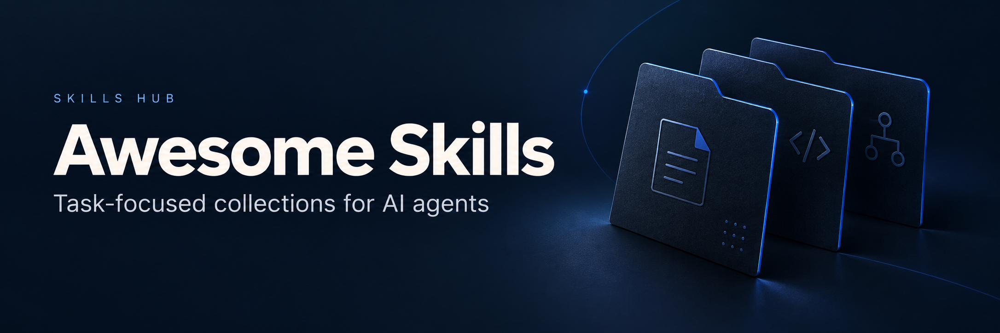

# Awesome Skills

为 [Skills Hub 桌面应用](https://github.com/qufei1993/skills-hub) 整理面向具体任务的技能合集。桌面应用负责管理和同步 Agent Skills，本仓库维护合集目录；Skills 保留在各自的上游仓库中。

[官网](https://aiskillshub.link) · [桌面应用](https://github.com/qufei1993/skills-hub) · [浏览合集](https://aiskillshub.link/collections) · [贡献指南](CONTRIBUTING.zh.md) · [英文版](README.md)

## 从这里开始

1. **找合集**：按下面的分类浏览，或在官网搜索你要完成的任务。
2. **了解用法**：打开合集介绍，查看场景、使用建议和上游 Skill 链接；按上游说明安装，并确认适用工具与许可。可用 [Skills Hub](https://aiskillshub.link/download) 管理 Skills。
3. **分享合集**：按[贡献指南](CONTRIBUTING.zh.md) 提交一份 README，或[提供收录建议](https://github.com/qufei1993/awesome-skills/issues/new?template=collection.yml)。

## 浏览合集

在 [Skills Hub 官网](https://aiskillshub.link/collections) 浏览已发布合集。下面的目录列出仓库中收录的合集，不代表已经发布或通过实测。

维护者通过 PR 审核后，发布流程生成正式数据。发布审核、来源核验、安装测试和工作流测试是不同状态；以官网及发布数据中的实际记录为准。

[开发与工程](#开发与工程) · [设计与视觉](#设计与视觉) · [产品与项目](#产品与项目) · [写作与内容](#写作与内容) · [营销与增长](#营销与增长) · [研究与学习](#研究与学习) · [数据与分析](#数据与分析) · [办公与效率](#办公与效率) · [音视频制作](#音视频制作) · [其他与综合](#其他与综合)

<!-- catalog:start -->
### 开发与工程

- [Ontoly Agent 技能](collections/development/0xsarwagya-ontoly/README.zh.md) — 通过共享 Software Graph 分析 JavaScript 和 TypeScript 仓库。
- [Hivemind 共享记忆技能](collections/development/activeloopai-hivemind/README.zh.md) — 检索团队知识，并将助手工作连接到持久目标和知识图谱。
- [Addy 的工程技能合集](collections/development/addy-agent-skills/README.zh.md) — 指导 AI 编程助手完成需求梳理、开发、测试、审查和发布准备。
- [网页质量技能合集](collections/development/addyosmani-web-quality-skills/README.zh.md) — 衡量并改善网页性能、无障碍、SEO 和工程质量。
- [ECC 技能合集](collections/development/affaan-m-ecc/README.zh.md) — 让编程助手协同完成规划、测试、审查、记忆管理和领域任务。
- [WGM 与配套技能](collections/development/agent-frontier-wgm/README.zh.md) — 将粗略需求转成可用软件，并帮助使用者理解产出。
- [Ahmed Asmar DevOps 技能](collections/development/ahmedasmar-devops-claude-skills/README.zh.md) — 操作基础设施、Kubernetes、CI/CD、GitOps、成本与可观测性。
- [Claude Bootstrap 与 Maggy 技能](collections/development/alinaqi-maggy/README.zh.md) — 为 Claude Code 加入测试约束工程、持久上下文与模型路由工作流。
- [Claude Code Skills & Agents Factory](collections/development/alirezarezvani-claude-code-skill-factory/README.zh.md) — 制作可复用的 Claude Skills、Agent、提示词、Hook 与编程命令。
- [Alireza Codex 技能索引](collections/development/alirezarezvani-claude-skills/README.zh.md) — 整理作者 Codex 索引中的工程、营销、产品、运营与研究技能。
- [AlterLab GameForge 游戏技能](collections/development/alterlab-ieu-alterlab-gameforge/README.zh.md) — 结合工作室角色、制作流程与引擎专家推进独立游戏项目。
- [AMD 技能](collections/development/amd-skills/README.zh.md) — 为 AMD 硬件与软件开发并优化 AI 工作负载。
- [任务委派技能合集](collections/development/amelnagdy-delegate-skills/README.zh.md) — 将实现委派给编程助手命令行工具，同时保留审查和提交职责。
- [质量检查技能合集](collections/development/amelnagdy-guard-skills/README.zh.md) — 交付前审查助手生成的代码、测试与文档。
- [审查技能](collections/development/amelnagdy-review-skills/README.zh.md) — 用两个模型角色辩论审查发现，并处理 PR 反馈。
- [Subagent CLI 技能](collections/development/amirkiarafiei-subagent-cli-skills/README.zh.md) — 通过无界面的命令行模式在编程 Agent 之间委派任务。
- [Andrew Gleave 的 Agent 技能](collections/development/andrewgleave-skills/README.zh.md) — 改善推理、代码可读性、工程决策与界面文字。
- [Angular 技能](collections/development/angular-skills/README.zh.md) — 用 Angular 团队的 Agent 指引创建与维护 Angular 应用。
- [Anthony Fu 技能合集](collections/development/antfu-skills/README.zh.md) — 使用 Anthony Fu 的工程偏好和 Vue 工具链文档指导。
- [DOS Kernel 编排与验证技能](collections/development/anthony-chaudhary-dos-kernel/README.zh.md) — 协调 Agent 工作，并依据仓库证据核实交付声明。
- [Aomi 技能](collections/development/aomi-labs-skills/README.zh.md) — 构建 Aomi 应用，并通过 CLI 操作区块链流程。
- [Apify 技能合集](collections/development/apify-agent-skills/README.zh.md) — 选择网页数据 Actor 并开发或接入 Apify 自动化。
- [Apollo GraphQL Agent 技能](collections/development/apollographql-skills/README.zh.md) — 设计并运行 GraphQL 结构、客户端、服务端、联邦与 Apollo 工具。
- [Archcore 项目上下文技能](collections/development/archcore-ai-archcore/README.zh.md) — 把规格、架构决策和分支评审与代码一起保存在 Git 中。
- [Loki Mode 与 Seal 技能](collections/development/asklokesh-loki-mode/README.zh.md) — 开展自主软件交付，并用测试证据检查完成声明。
- [Autohand 内置技能](collections/development/autohandai-code-cli/README.zh.md) — 用 Autohand 随附 Agent 工作流处理工程、研究与电脑任务。
- [Great CTO 技能](collections/development/avelikiy-great-cto/README.zh.md) — 让产品简报通过架构、实现、审查与安全门槛。
- [AWS 可移植技能合集](collections/development/aws-agent-toolkit-for-aws/README.zh.md) — 通过工具包完整的可移植目录开发和管理 AWS 应用。
- [Plannotator 审阅技能合集](collections/development/backnotprop-plannotator/README.zh.md) — 通过浏览器批注审阅计划、文档、代码变更和视觉产物。
- [DevOps 与安全技能合集](collections/development/bagelhole-devops-security-agent-skills/README.zh.md) — 建设和审查基础设施、交付系统与安全运维。
- [Bkircher 的 CLI 技能](collections/development/bkircher-skills/README.zh.md) — 通过专用命令行工具指导编程 Agent 完成工程任务。
- [agent-lsp 工作流技能](collections/development/blackwell-systems-agent-lsp/README.zh.md) — 通过语言服务器能力开展 Agent 代码导航、编辑、诊断与审查。
- [Claude Code Kit 技能](collections/development/blencorp-claude-code-kit/README.zh.md) — 把自动激活的框架指引与 Claude Code 项目基础配置一起安装。
- [Borghei 领域技能包](collections/development/borghei-claude-skills/README.zh.md) — 整理工程、产品、营销、运营及专业领域工作流。
- [Browserbase 技能合集](collections/development/browserbase-skills/README.zh.md) — 自动操作浏览器、记录证据并构建浏览器集成。
- [Spartan AI Toolkit 技能](collections/development/c0x12c-ai-toolkit/README.zh.md) — 用工程知识、可配置规则与质量门槛引导 Agent 交付。
- [Callstack React Native 技能合集](collections/development/callstackincubator-agent-skills/README.zh.md) — 依据 Callstack 生产经验开发、测试和迁移 React Native 应用。
- [Chaunsin 的 Agent 技能](collections/development/chaunsin-agent-skills/README.zh.md) — 处理数据库、Git、需求、发布评审与内容转换任务。
- [Forge Harness 技能](collections/development/chrono-meta-forge-harness/README.zh.md) — 维护项目规则、验证关卡与可重复的 Agent 工作流。
- [Cloudflare 技能合集](collections/development/cloudflare-skills/README.zh.md) — 在 Cloudflare 开发平台上构建和管理应用。
- [CodeRabbit 技能](collections/development/coderabbitai-skills/README.zh.md) — 通过 CodeRabbit Agent 集成审查代码并应用修复。
- [Crawlbase Codex 技能](collections/development/crawlbase-crawlbase-codex-plugin/README.zh.md) — 通过 Crawlbase MCP 抓取页面并管理存储结果。
- [Cypress AI Toolkit 技能](collections/development/cypress-io-ai-toolkit/README.zh.md) — 通过官方工具指导编写、讲解、研究和调查 Cypress 测试。
- [n8n 工作流技能合集](collections/development/czlonkowski-n8n-skills/README.zh.md) — 通过 n8n-mcp 指导构建、验证和运行 n8n 自动化。
- [Databricks AI Tools 技能](collections/development/databricks-databricks-agent-skills/README.zh.md) — 开发 Databricks 应用、作业、流水线、模型服务与部署包。
- [Datadog 代理技能源包](collections/development/datadog-labs-agent-skills/README.zh.md) — 整理 Datadog 接入、监控、调查与代理可观测性工作流。
- [Claude Code 基础设施技能合集](collections/development/diet103-claude-code-infrastructure-showcase/README.zh.md) — 通过自动技能激活应用真实项目中的工程约定。
- [Dimillian 开发技能合集](collections/development/dimillian-skills/README.zh.md) — 改进 Apple 平台应用与重复性工程工作。
- [Go Agent 技能包](collections/development/eduardo-sl-go-agent-skills/README.zh.md) — 整理 Go 架构、安全、质量、测试与开发流程。
- [Understand Anything 技能合集](collections/development/egonex-ai-understand-anything/README.zh.md) — 通过交互式知识图谱了解代码库与知识库。
- [Elastic Agent 技能](collections/development/elastic-agent-skills/README.zh.md) — 操作 Elasticsearch、Kibana、Observability、Security 与 Elastic Cloud。
- [EmblemAI Agent 技能](collections/development/emblemcompany-agent-skills/README.zh.md) — 使用 EmblemAI 工具构建钱包原生应用与加密资产流程。
- [Skills for Real Engineers](collections/development/engineering/README.zh.md) — 从需求澄清到实现与验证，把工程经验带进 Agent 协作。
- [Expo 技能合集](collections/development/expo-skills/README.zh.md) — 使用 Expo 团队流程开发、部署、升级和调试应用。
- [Firebase Agent 技能](collections/development/firebase-agent-skills/README.zh.md) — 用 Firebase 团队的 Agent 工作流开发 Firebase 应用。
- [QA Skills 测试工程技能](collections/development/fishzjp-qa-skills/README.zh.md) — 通过共享知识库与测试类型决策矩阵执行完整测试流程。
- [Flutter 技能合集](collections/development/flutter-agent-plugins/README.zh.md) — 使用 Flutter 团队流程开发、测试和调试 Flutter 与 Dart 应用。
- [Dev Agent 开发技能](collections/development/fvadicamo-dev-agent-skills/README.zh.md) — 在 Claude Code 中规范 Git、GitHub、隐私检查与技能编写。
- [Aegis 工程方法技能](collections/development/ganyuanran-aegis/README.zh.md) — 让编程助手遵循项目架构，并以证据验证完成情况。
- [Gstack 源码技能包](collections/development/garrytan-gstack/README.zh.md) — 把规划、设计、评审、测试和交付串成工程工作流。
- [Sentry for AI 源码技能包](collections/development/getsentry-sentry-for-ai/README.zh.md) — 整理 Sentry 接入、问题调试、埋点、告警与发布工作流。
- [Sentry 工程技能合集](collections/development/getsentry-skills/README.zh.md) — 应用 Sentry 的工程、审查、文档与沟通约定。
- [Awesome GitHub Copilot 技能合集](collections/development/github-awesome-copilot/README.zh.md) — 通过社区公开技能库扩展 Copilot 编程流程。
- [Kapso Agent 技能](collections/development/gokapso-agent-skills/README.zh.md) — 用 Kapso 开发与运行 WhatsApp 集成和自动化。
- [Gemini API 技能合集](collections/development/google-gemini-gemini-skills/README.zh.md) — 开发 Gemini 应用、实时交互和视频流程。
- [Google 产品技能合集](collections/development/google-skills/README.zh.md) — 使用 Google 公开技能开发和管理产品与云服务。
- [Open Agent Hub 技能包](collections/development/guanyang-open-agent-hub/README.zh.md) — 整理作者代理能力中心管理的开发、生产力与媒体技能。
- [HashiCorp Agent Skills](collections/development/hashicorp-agent-skills/README.zh.md) — 用 HashiCorp 的产品技能包开发 Terraform 基础设施与 Packer 镜像。
- [Emdash 产品开发技能](collections/development/heymegabyte-agent-skills/README.zh.md) — 通过工程、设计、内容与部署流程协同构建产品。
- [Skill Optimizer](collections/development/hqhq1025-skill-optimizer/README.zh.md) — 从真实工作挖掘、个性化并通用化 Agent 技能。
- [Hugging Face 技能合集](collections/development/huggingface-skills/README.zh.md) — 制作数据集、训练和评估模型并操作 Hugging Face Hub。
- [Brooks-Lint 工程审查技能](collections/development/hyhmrright-brooks-lint/README.zh.md) — 依据经典工程书籍开展结构化审查并诊断软件退化。
- [Logic-Lens 逻辑审查技能](collections/development/hyhmrright-logic-lens/README.zh.md) — 通过执行推演发现行为错误，并解释代码语义差异。
- [Blueprint 规划技能](collections/development/imbue-ai-blueprint/README.zh.md) — 澄清编程想法并产出 Agent 可执行计划。
- [Awesome Agent Skills 示例包](collections/development/jackyst0-awesome-agent-skills/README.zh.md) — 用作者可安装的示例开展审查、调试、文档、测试与提交工作。
- [Unity Agent 调试技能](collections/development/jahro-console-unity-agent-skills/README.zh.md) — 使用 Jahro 构建结构化 Unity 调试流程。
- [Jeff Allan 全栈技能合集](collections/development/jeffallan-claude-skills/README.zh.md) — 在语言、框架和交付阶段中使用专项工程指导。
- [Cavekit 规格技能存档](collections/development/juliusbrussee-cavekit/README.zh.md) — 通过持久规格推进软件变更的研究、实现与检查。
- [Kenji 技能](collections/development/kensaurus-skills/README.zh.md) — 执行面向 React、Next.js、Supabase 和 Agent 工具的工程流程。
- [Vibe 工作流技能合集](collections/development/khazp-vibe-coding-prompt-template/README.zh.md) — 从研究与产品需求推进到技术设计和验证后的实现。
- [Skills Janitor](collections/development/khendzel-skills-janitor/README.zh.md) — 检查技能上下文成本、重复项、安全与 MCP 使用情况。
- [KyberSwap 技能](collections/development/kybernetwork-kyberswap-skills/README.zh.md) — 跨 EVM 链查询、构建、模拟和管理 KyberSwap DeFi 操作。
- [TestMu 自动化测试技能](collections/development/lambdatest-agent-skills/README.zh.md) — 整理 TestMu AI 与 LambdaTest 生态的自动化测试流程。
- [LaunchDarkly Agent 技能](collections/development/launchdarkly-ai-tooling/README.zh.md) — 管理功能开关、AgentControl、指标和发布流程。
- [Mailtrap 邮件技能](collections/development/mailtrap-mailtrap-skills/README.zh.md) — 通过 Mailtrap 流程配置、发送、测试与管理邮件。
- [Notion CLI 与 Apps 技能](collections/development/makenotion-skills/README.zh.md) — 使用 Notion CLI，开发 Notion Apps、工作流与数据库同步。
- [Blode Agent 技能](collections/development/mblode-agent-skills/README.zh.md) — 改善架构、界面质量、写作、审查与软件发布。
- [Matteo Collina 开发技能合集](collections/development/mcollina-skills/README.zh.md) — 开发 Node.js 与 Fastify 应用并维护工程流程。
- [mirrord Agent 技能](collections/development/metalbear-co-skills/README.zh.md) — 通过 mirrord 在 Kubernetes 实际环境下开发本地代码。
- [Claude Skills Marketplace](collections/development/mhattingpete-claude-skills-marketplace/README.zh.md) — 组合工程工作流、可视化文档、代码操作与项目效率能力。
- [Azure 官方技能插件包](collections/development/microsoft-azure-skills/README.zh.md) — 覆盖 Azure 部署、管理、成本、图分析与知识工作流。
- [Microsoft SDK 与 Azure 插件技能包](collections/development/microsoft-skills/README.zh.md) — 为编码代理补充 Azure SDK、云工作流及 Microsoft AI 工具知识。
- [MiniMax 技能合集](collections/development/minimax-ai-skills/README.zh.md) — 使用 MiniMax 公开技能开发应用并制作文档与媒体。
- [AI Agent 本地与技能库管理合集](collections/development/moizibnyousaf-ai-agent-skills/README.zh.md) — 开发软件并管理经过整理的团队技能库。
- [MojoAuth Agent 技能](collections/development/mojoauth-skills/README.zh.md) — 跨应用框架实现托管无密码登录与机器认证。
- [MongoDB Agent 技能](collections/development/mongodb-agent-skills/README.zh.md) — 设计表结构、编写查询并使用 MongoDB 搜索与向量能力。
- [OpenCode Agent 技能](collections/development/mskadu-opencode-agent-skills/README.zh.md) — 改善 OpenCode 配置、权限、模型同步与 Git 流程。
- [社区网络安全技能合集](collections/development/mukul975-anthropic-cybersecurity-skills/README.zh.md) — 使用映射到安全框架的流程开展授权评估与防护。
- [上下文工程技能合集](collections/development/muratcankoylan-agent-skills-for-context-engineering/README.zh.md) — 设计助手的上下文、记忆、工具、执行循环和评估体系。
- [仓库工程技能](collections/development/natchannnn-repository-engineering-skills/README.zh.md) — 让代码评审和重构遵循仓库已有边界。
- [ax Agent 经验技能](collections/development/necmttn-ax/README.zh.md) — 通过本地经验图检查会话证据并改进 Agent 工作流。
- [发现未知技能库](collections/development/neeeophytee-finding-unknowns-skills/README.zh.md) — 实现改动前暴露盲点、上下文缺口与证据遗漏。
- [Context Engineering Kit 技能合集](collections/development/neolabhq-context-engineering-kit/README.zh.md) — 通过结构化开发流程改善助手推理和软件交付。
- [Neon Agent 技能](collections/development/neondatabase-agent-skills/README.zh.md) — 用 Neon Postgres、认证、分支、存储与 AI 服务开发云后端。
- [Netlify 平台技能](collections/development/netlify-context-and-tools/README.zh.md) — 依据平台专题参考构建和运维 Netlify 应用。
- [NVIDIA 技能合集](collections/development/nvidia-skills/README.zh.md) — 使用 NVIDIA 软件构建 AI、仿真、机器人与加速计算流程。
- [Superpowers Lab](collections/development/obra-superpowers-lab/README.zh.md) — 试用用于重复代码分析、MCP、终端与 Windows 虚拟机的实验性编程 Agent 工具。
- [OpenAI Codex 精选技能存档](collections/development/openai-skills/README.zh.md) — 浏览 OpenAI 早期用于开发、设计和连接应用的 Codex 技能。
- [Codex How To 工程技能](collections/development/phelan164-codex-howto/README.zh.md) — 在 Codex 流程中连接明确范围的实现、测试、评审与证据。
- [Agent Almanac 登记技能包](collections/development/pjt222-agent-almanac/README.zh.md) — 整理可执行的开发、研究、数据、运维与专业工作流。
- [Posit Agent 技能](collections/development/posit-dev-skills/README.zh.md) — 用 Posit 工作流开发 R 包、数据应用与开源项目。
- [Prisma 开发技能](collections/development/prisma-skills/README.zh.md) — 处理 Prisma 数据库配置、客户端查询、迁移、适配器与 Compute 部署。
- [ClawSec 安全技能合集](collections/development/prompt-security-clawsec/README.zh.md) — 检查助手运行时安全、验证签名通告并发现配置漂移。
- [Qdrant 向量搜索技能](collections/development/qdrant-skills/README.zh.md) — 为 Qdrant 向量搜索制定架构与性能决策。
- [Birdview 架构技能](collections/development/qiuner-birdview/README.zh.md) — 在修改代码库前检查架构、项目约束与技能兼容性。
- [Poka-Yoke 防错技能](collections/development/rainmanjam-poka-yoke/README.zh.md) — 将软件隐患与事故经验转化为预防错误的机制。
- [Harness Evolver 技能包](collections/development/raphaelchristi-harness-evolver/README.zh.md) — 诊断并改进代理提示词、路由、检索与编排。
- [Redis Agent 技能](collections/development/redis-agent-skills/README.zh.md) — 用 Redis 官方指引开发并优化 Redis 应用。
- [Replicate 技能](collections/development/replicate-skills/README.zh.md) — 为 Replicate 应用查找、比较、运行、开发与发布模型。
- [Resend 技能](collections/development/resend-resend-skills/README.zh.md) — 开发邮件投递、Agent 收件箱与 React 邮件模板。
- [Apple 无障碍审查技能](collections/development/rgmez-apple-accessibility-skills/README.zh.md) — 审查 SwiftUI、UIKit 和 AppKit 界面的无障碍体验。
- [Antigravity 技能库](collections/development/rmyndharis-antigravity-skills/README.zh.md) — 在 Google Antigravity 中应用专项开发、运维、安全和商业流程。
- [App Store Connect 命令行技能](collections/development/rorkai-app-store-connect-cli-skills/README.zh.md) — 通过 asc 命令行流程发布和管理 Apple 平台应用。
- [Comet 工作流技能合集](collections/development/rpamis-comet/README.zh.md) — 以明确阶段和评估结果继续长期编程任务。
- [Itqan 工程技能](collections/development/saleh-alhaddad-itqan-engineering/README.zh.md) — 通过分阶段决策与完成证据执行可续接的工程流程。
- [Sanity Agent Toolkit 技能](collections/development/sanity-io-agent-toolkit/README.zh.md) — 从 Studio 与表结构推进到前端集成，开发 Sanity 内容系统。
- [Scarlet Agent 技能](collections/development/scarletkc-agents/README.zh.md) — 在日常开发中复用跨 Agent 标准与任务流程。
- [Cloclo 项目技能快照](collections/development/seifbenayed-cloclo/README.zh.md) — 整理 Cloclo 已跟踪项目技能中的开发、文档与浏览器流程。
- [Sendmux 邮件技能](collections/development/sendmux-skills/README.zh.md) — 将 Agent 邮件流程连接到 Sendmux 邮箱、附件、CLI 和 MCP。
- [Claude Code 开发工作流](collections/development/shinpr-claude-code-workflows/README.zh.md) — 规划、设计、实现并独立审查后端、前端与全栈改动。
- [Markstream 集成技能合集](collections/development/simon-he95-markstream-vue/README.zh.md) — 将流式 Markdown 渲染接入不同前端框架的应用。
- [AuraKit 开发技能](collections/development/smorky850612-aurakit/README.zh.md) — 结合 Aura 工作模式、上下文压缩与防护检查编排开发任务。
- [Agent Starter 技能](collections/development/sneg55-agent-starter/README.zh.md) — 通过项目级改进循环创建或改造适合 Agent 协作的项目。
- [Sparkling Dispatch 技能](collections/development/sparklingneuronics-sparkling-skills/README.zh.md) — 从 Claude Code 请求 Codex 与 Gemini 的独立意见。
- [squirrelscan 审查技能](collections/development/squirrelscan-skills/README.zh.md) — 爬取网站，把 SEO、性能、安全与无障碍发现转为修复任务。
- [SSOJet Agent 技能](collections/development/ssojet-skills/README.zh.md) — 在应用中实现 SSOJet 认证、团队管理和用户预配。
- [前端架构技能](collections/development/stareezy-1-frontend-architecture-skill/README.zh.md) — 结合契约、变更、SEO 与可观测性组织 React 和 React Native 前端。
- [Stripe 技能合集](collections/development/stripe-ai/README.zh.md) — 依据 Stripe 工程流程开发和维护平台集成。
- [Supabase 技能合集](collections/development/supabase-agent-skills/README.zh.md) — 开发 Supabase 应用并改善 PostgreSQL 设计和性能。
- [Supercov 技能](collections/development/supercorp-ai-supercov/README.zh.md) — 衡量覆盖率与代码质量，并为 Agent 提供明确改进目标。
- [Nika 插件技能](collections/development/supernovae-st-nika-plugins/README.zh.md) — 编写、检查、调试、迁移和运行可重复的 Nika 流程。
- [Superpowers · 软件开发](collections/development/superpowers/README.zh.md) — 用可组合的开发 Skills，引导编程 Agent 完成设计、规划、实现、调试与评审。
- [Open Dynamic Workflows 技能](collections/development/suraj1235-open-dynamic-workflows/README.zh.md) — 通过本地编排服务规划并执行多 Agent 编程任务。
- [Takeaseat DevOps 技能](collections/development/takeaseatventure-devops-skills/README.zh.md) — 诊断定时任务、环境差异和 Dockerfile 问题。
- [PUA 助手工作流程技能](collections/development/tanweai-pua/README.zh.md) — 帮助编程助手持续排错、验证结果并主动推进任务。
- [Playwright 技能指南](collections/development/testdino-hq-playwright-skill/README.zh.md) — 用 TestDino 完整指南包编写、调试、扩展与迁移 Playwright 测试。
- [Claude-Mem 插件技能](collections/development/thedotmack-claude-mem/README.zh.md) — 围绕持久记忆检索历史工作并组织编程任务。
- [Agentic Skills 最佳实践](collections/development/timwukp-agent-skills-best-practice/README.zh.md) — 使用面向 AWS、DevSecOps、工程角色和技能开发的可移植流程。
- [Tinybird Agent 技能](collections/development/tinybirdco-tinybird-agent-skills/README.zh.md) — 构建 Tinybird 数据资源，并通过 CLI 与 SDK 管理项目。
- [Crit 审阅技能合集](collections/development/tomasz-tomczyk-crit/README.zh.md) — 通过浏览器行内反馈审阅计划、代码变更与运行界面。
- [Trail of Bits 安全技能合集](collections/development/trailofbits-skills/README.zh.md) — 协助安全分析、漏洞研究和严谨的软件测试。
- [Transloadit 技能](collections/development/transloadit-skills/README.zh.md) — 通过 Transloadit 构建上传、素材分发与媒体转换流程。
- [AgentFlow 技能](collections/development/urrhb-agentflow/README.zh.md) — 利用看板、工作 Agent 和质量关卡协调开发。
- [摸鱼工程约束技能](collections/development/uucz-moyu/README.zh.md) — 把编程 Agent 改动保持在请求范围内，并约束过度工程。
- [Venice API 技能](collections/development/veniceai-skills/README.zh.md) — 集成 Venice 文本、媒体、模型路由、认证与账号 API。
- [Agent Browser 浏览器流程技能](collections/development/vercel-labs-agent-browser/README.zh.md) — 使用 agent-browser 内置流程执行浏览器任务。
- [Vercel 技能合集](collections/development/vercel-labs-agent-skills/README.zh.md) — 使用 Vercel 技能改进 React 应用并管理 Vercel 项目。
- [Kilo-Kit 技能 registry](collections/development/vodailocz-kilo-kit-mcp/README.zh.md) — 整理编码代理的技能路由、规划、验证与知识工作流。
- [VoltAgent 技能包](collections/development/voltagent-skills/README.zh.md) — 建立 VoltAgent 项目并查阅框架模式与版本对应文档。
- [AG Kit 技能合集](collections/development/vudovn-ag-kit/README.zh.md) — 使用 Antigravity 项目级工程工具包开发应用。
- [Vue 开发技能合集](collections/development/vuejs-ai-skills/README.zh.md) — 为 Vue 3 应用开发提供组件、路由、状态管理、测试和调试指导。
- [Weights & Biases 技能](collections/development/wandb-skills/README.zh.md) — 辅助编程 Agent 分析 W&B 实验、开展训练研究并接入应用追踪。
- [Weaviate Agent 技能](collections/development/weaviate-agent-skills/README.zh.md) — 开发并查询使用 Weaviate 的 AI 应用。
- [Atlas 目标约束技能](collections/development/wede-wx-atlas/README.zh.md) — 用明确的目标契约和可复用经验约束 Agent 工作。
- [Swift 服务端技能](collections/development/wendylabsinc-claude-skills/README.zh.md) — 使用作者的工程指导开发 Swift 服务与 Wendy 集成。
- [fp-ts 技能](collections/development/whatiskadudoing-fp-ts-skills/README.zh.md) — 结合专题指南和快速参考应用实用的函数式 TypeScript 模式。
- [FAF 项目上下文技能](collections/development/wolfe-jam-faf-skills/README.zh.md) — 建立持续项目背景，并对齐 project.faf、Agent 指导与测试。
- [WordPress 技能合集](collections/development/wordpress-agent-skills/README.zh.md) — 依据 WordPress 团队指导开发、审查和管理项目。
- [Wshobson 工程流程技能合集](collections/development/wshobson-agents/README.zh.md) — 使用多助手插件市场中的专项工程流程。
- [YK 开发体验技能合集](collections/development/ykdojo-claude-code-tips/README.zh.md) — 通过开发与研究辅助技能改善助手日常工作。
- [YYLO 技能](collections/development/yylo-dev-yylo-skills/README.zh.md) — 管理项目理解、任务台账、流程记录、基准与执行循环。
- [RouterBase Agent 技能](collections/development/zenlee123-routerbase-agent-skills/README.zh.md) — 接入 RouterBase API，并规划模型路由或媒体生成流程。
- [Makepad 2.0 技能库](collections/development/zhanghandong-makepad-skills/README.zh.md) — 以框架专用的设计和实现指引开发跨平台 Makepad 2.0 界面。
- [Reverse Skill 安全路由合集](collections/development/zhaoxuya520-reverse-skill/README.zh.md) — 将授权安全研究和 CTF 任务路由至专项分析流程。
- [Claude Code AWS 技能](collections/development/zxkane-aws-skills/README.zh.md) — 设计 AWS 基础设施、运营、无服务器系统与 AI Agent 部署。

### 设计与视觉

- [KiCad Happy 技能合集](collections/design/aklofas-kicad-happy/README.zh.md) — 审查电子设计并衔接原型到生产流程。
- [Bria AI 图像技能](collections/design/bria-ai-bria-skill/README.zh.md) — 通过 Bria 模型和结构化视觉提示生成、编辑图像。
- [Three.js 技能合集](collections/design/cloudai-x-threejs-skills/README.zh.md) — 通过专项接口与实现指导制作交互式三维场景。
- [Dembrandt 界面设计技能](collections/design/dembrandt-dembrandt-skills/README.zh.md) — 将企业级 UX 判断用于设计系统、界面与无障碍评审。
- [Text-to-CAD 技能合集](collections/design/earthtojake-text-to-cad/README.zh.md) — 让助手设计 CAD 模型、检查制造限制并准备打印。
- [平台设计技能](collections/design/ehmo-platform-design-skills/README.zh.md) — 依据 Apple HIG、Material Design 与 WCAG 指引设计和评估界面。
- [Emil Kowalski 界面技能合集](collections/design/emilkowalski-skills/README.zh.md) — 围绕动效和交互细节制作与审查界面。
- [Figma MCP 技能合集](collections/design/figma-mcp-server-guide/README.zh.md) — 制作和检查 Figma 设计，并衔接实现与项目规划。
- [Stitch 插件技能包](collections/design/google-labs-code-stitch-skills/README.zh.md) — 通过 Stitch 工作流与工具完成界面设计和实现。
- [GSAP 技能合集](collections/design/greensock-gsap-skills/README.zh.md) — 在不同网页框架中制作正确高效的 GSAP 动效。
- [智能图像提示词技能](collections/design/huangserva-skill-prompt-generator/README.zh.md) — 生成图像提示词，并从现有提示词中学习可复用视觉元素。
- [Web 动画技能](collections/design/iart-ai-web-animation-skills/README.zh.md) — 结合 GSAP、SVG、Lottie 与无障碍交互模式制作网页动画。
- [WebGL 动画技能](collections/design/iart-ai-webgl-animation-skills/README.zh.md) — 制作 Three.js 动画、GLSL 效果与粒子系统。
- [Ibelick 界面技能合集](collections/design/ibelick-ui-skills/README.zh.md) — 改进界面质量、无障碍、元数据和动效。
- [reimagine-it 设计技能](collections/design/kayforkind-reimagine-it/README.zh.md) — 用 reimagine-it 引擎根据真实内容重设计现有 HTML。
- [Modellix 插件技能](collections/design/modellix-modellix-plugin/README.zh.md) — 通过 Modellix 准备提示并生成图片、视频或音频。
- [UI UX Pro Max 设计技能包](collections/design/nextlevelbuilder-ui-ux-pro-max-skill/README.zh.md) — 协助界面、品牌、横幅、设计系统、幻灯片与 UI 样式设计。
- [Taste Skill · 前端设计](collections/design/taste/README.zh.md) — 从排版、风格到动效，让 AI 生成的界面更有设计感。
- [UIZZE 界面技能](collections/design/uizze-uizze/README.zh.md) — 结合设计指导与参考研究构建符合产品特点的界面。
- [UX/UI Principles 技能](collections/design/uxuiprinciples-agent-skills/README.zh.md) — 通过专项 UX 评审检查界面、用户流程和 AI 交互。
- [Anatomy](collections/design/wheresryan22-anatomy/README.zh.md) — 用 SVG 构建细节丰富、可交互的等距机械与仪器模型，解释技术概念。

### 产品与项目

- [Dean Peters 产品经理技能合集](collections/product/deanpeters-product-manager-skills/README.zh.md) — 通过专项技能和引导工作坊应用产品框架。
- [dontbesilent 商业技能合集](collections/product/dontbesilent2025-dbskill/README.zh.md) — 诊断商业与内容问题并整理为具体行动。
- [自由职业动态设计技能](collections/product/iart-ai-freelance-motion-skills/README.zh.md) — 管理动态设计简报、报价、修订、交付与品牌规范。
- [俄罗斯小企业经营技能](collections/product/ilyautov-small-business-ru/README.zh.md) — 结合本地财务、税务、客户与招聘流程辅助俄罗斯小企业经营。
- [PM 产品管理技能市场](collections/product/phuryn-pm-skills/README.zh.md) — 指导产品发现、策略、执行、发布和增长决策。
- [Product on Purpose 产品管理技能](collections/product/product-on-purpose-pm-skills/README.zh.md) — 推动产品工作完成发现、定义、交付、衡量与迭代。
- [Claude Code 创业技能](collections/product/rameerez-claude-code-startup-skills/README.zh.md) — 结合客户思考、媒体处理与 X 发布辅助创业工作。
- [Solo Skills 独立开发技能](collections/product/rockscy-solo-skills/README.zh.md) — 处理独立创始人的决策、客户回复、发布写作与短复盘。
- [TasteRay 偏好与推荐技能](collections/product/tasteray-skills/README.zh.md) — 通过对话理解用户偏好，并据此提供推荐。

### 写作与内容

- [AlterLab 传播学技能](collections/writing/alterlab-ieu-alterlab-fc-skills/README.zh.md) — 面向六个专业方向完成传播学课程任务与作品。
- [Avoid AI Writing 插件技能](collections/writing/conorbronsdon-avoid-ai-writing/README.zh.md) — 审查和修改英文写作，同时保留语气、意义与受保护内容。
- [prompts.chat 插件技能](collections/writing/f-prompts-chat/README.zh.md) — 通过 prompts.chat 的 Claude Code 插件查找可复用提示词和技能。
- [LinkDigest 内容读取技能](collections/writing/jcaiagent7143-ui-linkdigest-mcp/README.zh.md) — 把社交媒体链接转成逐字稿、图片文字与可核对资料。
- [宝玉技能合集](collections/writing/jimliu-baoyu-skills/README.zh.md) — 制作图文内容并发布到文章与社交平台。
- [Slop Grader 文本评审技能](collections/writing/lukstei-slop-grader/README.zh.md) — 编写文本检查规则，并将逐行评分结果转化为具体修改。
- [Unslop 写作技能](collections/writing/mohamedabdallah-14-unslop/README.zh.md) — 修改程式化表达，并保留事实、含义与个人表达。
- [Sepia 写作技能合集](collections/writing/nanako0129-sepia/README.zh.md) — 通过结构审查与谨慎修改改善小说和专业文稿。
- [VoiceMoat 写作技能](collections/writing/prateeks367-voicemoat-skills/README.zh.md) — 保持 LinkedIn 与 X 内容语气一致，并在发布前审阅。
- [中文写作与改稿技能](collections/writing/swaylq-humanize-chinese/README.zh.md) — 结合本地文本检查工具撰写、修改和校对中文。
- [ru-text 俄语编辑技能](collections/writing/talkstream-ru-text/README.zh.md) — 校对俄语排版、官样表达与机器写作痕迹。

### 营销与增长

- [Aaron 营销技能合集](collections/marketing/aaron-he-zhu-aaron-marketing-skills/README.zh.md) — 协同完成品牌叙事、渠道、发布和审查关卡。
- [Claude SEO 技能合集](collections/marketing/agricidaniel-claude-seo/README.zh.md) — 审查技术 SEO、内容、结构化数据和 AI 搜索准备情况。
- [GTM 商业合伙人技能](collections/marketing/aidevgtm-gtm-cofounder/README.zh.md) — 为商业支持有限的技术产品建立上市推广计划。
- [Appeeky 应用商店优化技能](collections/marketing/appeeky-aso-skills/README.zh.md) — 研究并改善应用商店获客、转化和增长。
- [Distribb SEO 技能](collections/marketing/bomx-distribb-skill/README.zh.md) — 开展 SEO、发布、社交再利用与分阶段九十天增长冲刺。
- [Brian Wagner AI 营销技能](collections/marketing/brianrwagner-ai-marketing-claude-code-skills/README.zh.md) — 为营销业务建立定位、影响力、研究与转化工作流。
- [GTM 技能栈](collections/marketing/chadboyda-agent-gtm-skills/README.zh.md) — 规划定位、定价、外联、获客、留存与收入运营。
- [Citlyze Agent 技能](collections/marketing/citlyze-citlyze-skills/README.zh.md) — 审查网页并分析品牌在 AI 搜索中的可见性。
- [Cogny 营销技能](collections/marketing/cognyai-claude-code-marketing-skills/README.zh.md) — 审查 SEO 与广告、研究竞品并筛选潜在客户，可选连接业务数据。
- [Corey Haines 营销技能合集](collections/marketing/coreyhaines31-marketingskills/README.zh.md) — 让助手协助营销策略、文案、转化优化和增长工作。
- [Goose 品牌增长技能](collections/marketing/gooseworks-ai-goose-skills/README.zh.md) — 研究受众、制作营销活动，并根据增长结果改进工作。
- [广告视频技能](collections/marketing/iart-ai-ad-video-skills/README.zh.md) — 制作广告变体、产品发布影片和客户评价视频。
- [Digital Marketing Pro](collections/marketing/indranilbanerjee-digital-marketing-pro/README.zh.md) — 以共享策略文档规划并执行多品牌营销项目。
- [Infrasity 开发者 GTM 技能包](collections/marketing/infrasity-labs-dev-gtm-claude-skills/README.zh.md) — 整理开发者营销、搜索可见性、写作、设计与产品工作流。
- [SuperSEO 技能](collections/marketing/inhouseseo-superseo-skills/README.zh.md) — 研究并制作 SEO 审查、内容简报、文章与外链计划。
- [Suede Creator 技能](collections/marketing/jasoncolapietro-suede-creator-skills/README.zh.md) — 协调 SEO、转化、业务运营、创意与软件交付。
- [开发者营销技能](collections/marketing/jonathimer-devmarketing-skills/README.zh.md) — 通过文档、社区、发现渠道与开发者体验推广技术产品。
- [Linked API LinkedIn 技能](collections/marketing/linked-api-linkedin-skills/README.zh.md) — 用 Linked API 工具操作 LinkedIn 工作流与增长例行任务。
- [Marketing CLI 技能包](collections/marketing/moizibnyousaf-marketing-cli/README.zh.md) — 整理研究、品牌记忆、内容、增长与营销编排工作流。
- [NotFair 营销技能合集](collections/marketing/nowork-studio-notfair-plugin/README.zh.md) — 审查搜索可见性、调查广告支出并改进连接式营销工作。
- [创始人技能库](collections/marketing/ognjengt-founder-skills/README.zh.md) — 为创始人主导的业务制作产品、营销与运营文档。
- [Rampstack 品牌建设技能合集](collections/marketing/rampstackco-claude-skills/README.zh.md) — 通过连贯流程库建设、发布、运营并发展品牌与网站。
- [AI Agent 广告技能库](collections/marketing/realkimbarrett-advertising-skills/README.zh.md) — 组织直接响应广告、付费媒体与转化文案。
- [一人公司技能合集](collections/marketing/resciencelab-opc-skills/README.zh.md) — 研究市场并制作小型业务发布所需素材。
- [LinkedIn 营销技能合集](collections/marketing/sergebulaev-linkedin-skills/README.zh.md) — 用一致的个人语气规划、撰写和审查 LinkedIn 内容。
- [SuperCMO 营销技能](collections/marketing/supercmohq-supercmo-skills/README.zh.md) — 从产品照片、创意简报与生成素材制作营销活动。
- [UnifAPI 营销 Agent](collections/marketing/unifapi-agent-agents/README.zh.md) — 通过 UnifAPI 实时公开数据研究营销决策。
- [谈判与说服技能](collections/marketing/yanniskiefer-dark-psychology-skills/README.zh.md) — 准备销售对话、谈判回应，并识别操纵性手法。
- [GEO SEO Claude 技能合集](collections/marketing/zubair-trabzada-geo-seo-claude/README.zh.md) — 审查网站在 AI 搜索中的可见性与准备情况。

### 研究与学习

- [AlterLab 学术技能](collections/research/alterlab-ieu-alterlab-academic-skills/README.zh.md) — 开展研究、验证引用、分析科学数据并准备学术成果。
- [全知晓四模块套件](collections/research/asi2030-fact-check-x/README.zh.md) — 采集回答、比较知识点、核验依据并组织事实核查。
- [Brave Search API 技能](collections/research/brave-brave-search-skills/README.zh.md) — 用 Brave 网络、媒体、新闻与本地搜索数据支撑 Agent 回答。
- [DAIR Academy 插件技能](collections/research/dair-ai-dair-academy-plugins/README.zh.md) — 用 DAIR Academy 插件制作学习材料、研究 Wiki 与 AI 学习工作流。
- [Firecrawl CLI 技能](collections/research/firecrawl-cli/README.zh.md) — 通过 Firecrawl CLI 搜索、抓取、爬取并检查网络与研究资料。
- [Firecrawl 技能目录](collections/research/firecrawl-skills/README.zh.md) — 使用 Firecrawl 正式网络基础操作及研究、提取流程。
- [教育 Agent 技能库](collections/research/garethmanning-education-agent-skills/README.zh.md) — 用基于教育研究的技能规划教学与学习者互动。
- [机械工程研究技能](collections/research/hanhuark-mechanical-engineering-research-skill/README.zh.md) — 结合专业分析、写作、数据与评审流程开展热流体研究。
- [材料模拟技能](collections/research/heshamfs-materials-simulation-skills/README.zh.md) — 用稳定性检查、收敛研究和可复现流程辅助数值模拟。
- [Skills for Humanity](collections/research/human-avatar-skills-for-humanity/README.zh.md) — 用结构化推理方法分析决策、激励、系统与复杂问题。
- [科学研究技能合集](collections/research/k-dense-ai-scientific-agent-skills/README.zh.md) — 协助文献检索、科学数据分析、建模和研究成果表达。
- [Orchestra AI 研究技能合集](collections/research/orchestra-research-ai-research-skills/README.zh.md) — 从模型实验推进到评估与研究成果发表。
- [SandBase 技能](collections/research/sandbaseai-sandbase-skills/README.zh.md) — 研究并交叉核对证据，再应用于营销工作流。
- [ScrapeCreators 社交研究技能](collections/research/scrapecreators-social-media-research-skills/README.zh.md) — 将公开社交数据整理为竞争、受众和内容研究。
- [事实核查技能库](collections/research/serhiikorniienko-bullshit-detector/README.zh.md) — 提取主张、核对证据并发布带来源评估。
- [Stipple Agent 技能](collections/research/sketchjar-stipple-agent-skills/README.zh.md) — 核验文档和引用、提取证据并筛查公开信息。
- [ARIS 研究技能合集](collections/research/wanshuiyin-auto-claude-code-research-in-sleep/README.zh.md) — 通过独立审查、实验与论文流程组织自主研究。
- [CrossFrame Skill Suite](collections/research/xi-kari-crossframe-skill/README.zh.md) — 面向中文结构诊断、公共议题、组织和历史材料开展分析。
- [MFS 上下文技能](collections/research/zilliztech-mfs/README.zh.md) — 从代码、文件、知识与已连接来源摄取并检索相关上下文。

### 数据与分析

- [AgentBody 技能](collections/data/agentbody-skills/README.zh.md) — 通过 AgentBody API 研究公开平台并处理文档。
- [Binance 技能中心合集](collections/data/binance-binance-skills-hub/README.zh.md) — 通过助手指令访问 Binance 与 Web3 数据和账号流程。
- [ClickHouse Agent 技能](collections/data/clickhouse-agent-skills/README.zh.md) — 设计、优化与运行 ClickHouse 和 chdb 分析工作负载。
- [CoinPaprika 与 DexPaprika 技能](collections/data/coinpaprika-skills/README.zh.md) — 通过 Paprika API 查询中心化与去中心化加密市场数据。
- [DuckDB 技能](collections/data/duckdb-duckdb-skills/README.zh.md) — 用 DuckDB 探索文件与数据库，并保留查询会话背景。
- [Honeydew AI 数据技能](collections/data/honeydew-ai-honeydew-ai-coding-agents-plugins/README.zh.md) — 通过 Honeydew MCP 构建语义数据模型并查询数据。
- [长桥金融数据技能](collections/data/longbridge-skills/README.zh.md) — 通过长桥工具查询行情、持仓与公司信息。
- [Looot 数据技能](collections/data/loootai-looot-skills/README.zh.md) — 通过共享数据 API 目录执行研究与信息补全任务。
- [Monte Carlo 代理工具包技能](collections/data/monte-carlo-data-mc-agent-toolkit/README.zh.md) — 整理 Monte Carlo 工具包的数据与代理可观测性工作流。
- [OpenAccountants 代理技能快照](collections/data/openaccountants-openaccountants/README.zh.md) — 整理作者已跟踪 Agent Skills 快照中的会计与税务工作流。
- [A 股分析与模拟交易技能](collections/data/shouldnotappearcalm-a-share-skill/README.zh.md) — 分析中国股票、筛选技术信号并开展模拟交易。
- [TraderSpy 技能](collections/data/target1m-traderspy-mcp/README.zh.md) — 通过 TraderSpy MCP 读取加密市场信号、头寸、筛选和技术数据。
- [Xberg 文档智能技能合集](collections/data/xberg-io-xberg/README.zh.md) — 通过 Xberg 多语言处理工具提取和分析文档。
- [Xquik X 数据技能](collections/data/xquik-dev-x-twitter-scraper/README.zh.md) — 通过 Xquik API 工具搜索 X 帖子、资料、回复与受众。
- [YouTube TranscriptAPI 技能合集](collections/data/zeropointrepo-youtube-skills/README.zh.md) — 通过 TranscriptAPI 获取 YouTube 文本、搜索、频道和播放列表。
- [Zillow 房产数据技能](collections/data/zeropointrepo-zillow-skills/README.zh.md) — 通过 Zillapi 查询估价、房源、可比房产和历史数据。

### 办公与效率

- [Aeon 自主 Agent 技能库](collections/productivity/aeonfun-aeon/README.zh.md) — 通过 Aeon Agent 框架安排仓库工作、研究与周期任务。
- [英文效率技能包](collections/productivity/alapha888-agent-skills-en/README.zh.md) — 校对技术写作，并组织会议、研究和工程记录。
- [Anthropic 技能合集](collections/productivity/anthropics-skills/README.zh.md) — 使用 Anthropic 公开技能制作文档、视觉作品和技术产物。
- [Memory Kit 记忆技能](collections/productivity/awrshift-agent-memory-kit/README.zh.md) — 跨 Agent 会话保存经过确认且带日期的项目记忆。
- [Obsidian 学习仓库辅导技能](collections/productivity/bevibing-tutor-skills/README.zh.md) — 将文档或代码转为 Obsidian 学习仓库并检验理解。
- [Browser Act 浏览器技能包](collections/productivity/browser-act-skills/README.zh.md) — 提供浏览器自动化及调研、获客、电商、社交数据工作流。
- [Busabase 技能](collections/productivity/busabase-skills/README.zh.md) — 操作基于审批的知识工作区，并构建原生工作区应用。
- [Composio Codex 技能合集](collections/productivity/composio-community-awesome-codex-skills/README.zh.md) — 通过 Composio 的 Codex 技能库处理办公、开发和应用任务。
- [Composio Claude 技能合集](collections/productivity/composiohq-awesome-claude-skills/README.zh.md) — 使用 Composio 技能库完成文档、开发和应用自动化任务。
- [OpenPaw 技能包](collections/productivity/daxaur-openpaw/README.zh.md) — 整理 Claude Code 个人助理配置与工作习惯。
- [Daymade 工作流程技能合集](collections/productivity/daymade-claude-code-skills/README.zh.md) — 通过 Daymade 技能市场处理开发、文档、研究、媒体和桌面任务。
- [SlideOps 演示技能](collections/productivity/glukicov-slideops/README.zh.md) — 生成有代码依据的演示文稿，并检查内容何时与仓库发生偏差。
- [Google Workspace 命令行技能合集](collections/productivity/googleworkspace-cli/README.zh.md) — 操作 Workspace 服务并组合成日常办公流程。
- [Hermes 中文实用技能包](collections/productivity/jiawood2006-hermes-skills/README.zh.md) — 整理中文视频转写、文档 OCR、写作与电商媒体流程。
- [纳瓦尔宝典技能包](collections/productivity/kangarooking-cangjie-skill/README.zh.md) — 通过已发布的纳瓦尔路由和六项晋级技能处理决策与工作问题。
- [Obsidian 技能合集](collections/productivity/kepano-obsidian-skills/README.zh.md) — 管理 Obsidian 仓库并编写 Markdown、Bases 和 Canvas 文件。
- [PPTX Deck Creation Kit](collections/productivity/kimtth-agent-pptify-kit/README.zh.md) — 通过明确幻灯片规格和原生对象制作可编辑 PowerPoint。
- [飞书命令行技能合集](collections/productivity/larksuite-cli/README.zh.md) — 通过官方命令行流程操作 Lark 与飞书业务服务。
- [Notion 工作区插件技能](collections/productivity/makenotion-claude-code-notion-plugin/README.zh.md) — 在 Notion 中沉淀知识、准备会议、记录研究与落实规格。
- [Notion MCP 工作流技能](collections/productivity/makenotion-notion-cookbook/README.zh.md) — 在 Notion 中捕获知识、规划项目、开展研究并管理工作台账。
- [Accreted Intelligence 技能](collections/productivity/maxbaluev-accreted-intelligence/README.zh.md) — 通过本地工作模型保存承诺、任务框架与基于结果的经验。
- [Tapestry 技能](collections/productivity/michalparkola-tapestry-skills/README.zh.md) — 把文章与视频转成学习计划和具体行动。
- [PM 专业工作技能合集](collections/productivity/mohitagw15856-pm-claude-skills/README.zh.md) — 使用结构化框架与可复用产物完成专业和日常任务。
- [AI Brain Starter 技能包](collections/productivity/mycelium-hq-ai-brain-starter/README.zh.md) — 整理记忆、日志、责任跟踪与个人知识工作流。
- [Emulo 工作画像技能](collections/productivity/ohad6k-emulo/README.zh.md) — 把选定编程 Agent 会话证据转为可复用的个人工作画像。
- [OneWave AI 单文件技能包](collections/productivity/onewave-ai-claude-skills/README.zh.md) — 整理销售、营销、设计、工程与代理工作流。
- [Odai 任务执行技能](collections/productivity/orziz-odai/README.zh.md) — 对齐目标与验收，再执行并验证 Agent 工作。
- [简历与职业技能合集](collections/productivity/paramchoudhary-resumeskills/README.zh.md) — 准备真实准确的简历、申请、面试与职业决策。
- [Sanjay AI Agent 技能](collections/productivity/sanjay3290-ai-skills/README.zh.md) — 连接数据库、工作区服务、研究、媒体工具与委派编程任务。
- [Skywork 技能](collections/productivity/skyworkai-skywork-skills/README.zh.md) — 用 Skywork 制作演示文稿、文档、表格、图片、研究与音乐。
- [Agent Knowledge 项目知识技能](collections/productivity/stjbrown-agent-knowledge/README.zh.md) — 用可移植的 Markdown 知识包维护关联项目百科。
- [结构化思考技能合集](collections/productivity/tjboudreaux-cc-thinking-skills/README.zh.md) — 为决策与复杂问题选择并应用明确推理流程。
- [HubSpot 管理技能](collections/productivity/tomgranot-hubspot-admin-skills/README.zh.md) — 审查、清理、丰富、评分、自动化并维护 HubSpot CRM。
- [WPS 笔记技能](collections/productivity/wpsnote-wpsnote-skills/README.zh.md) — 通过 WPS 笔记捕获、整理、创作与学习。
- [Best Skills 通用技能包](collections/productivity/xstongxue-best-skills/README.zh.md) — 整理写作、开发、办公文件及日常工作流程。
- [Zapier MCP 插件技能](collections/productivity/zapier-zapier-mcp/README.zh.md) — 配置 Zapier MCP，并在已连接应用中执行面向不同角色的工作。
- [Zinc 购物技能](collections/productivity/zincio-skills/README.zh.md) — 通过 Zinc API 搜索零售商品并管理订单。

### 音视频制作

- [Beatra 创意技能](collections/media/beatra-ai-beatra-skills/README.zh.md) — 通过 Beatra 规划、指导和渲染图片、视频、音乐与声音。
- [Claude AI 音乐技能](collections/media/bitwize-music-studio-claude-ai-music-skills/README.zh.md) — 从概念与歌词推进到母带处理和发行准备，制作完整专辑。
- [Black Forest Labs FLUX 技能](collections/media/black-forest-labs-skills/README.zh.md) — 编写 FLUX 图片与视频提示，并集成 BFL 生成 API。
- [Claude Code 视频工具箱技能](collections/media/digitalsamba-claude-code-video-toolkit/README.zh.md) — 将视频想法转为生成素材、录制画面和最终 MP4。
- [ElevenLabs 技能](collections/media/elevenlabs-skills/README.zh.md) — 用 ElevenLabs 开发语音、音频、音乐、配音与语音 Agent 功能。
- [fal AI 技能包](collections/media/fal-ai-community-skills/README.zh.md) — 通过 fal 工具完成图像、视频、音频与媒体工作流。
- [数据动画技能](collections/media/iart-ai-data-animation-skills/README.zh.md) — 将结构化数据转成动态图表、信息图和演示视频。
- [电商视频技能包](collections/media/iart-ai-ecommerce-video-skills/README.zh.md) — 根据提供的素材制作产品演示、促销短片与照片幻灯片。
- [讲解视频技能](collections/media/iart-ai-explainer-video-skills/README.zh.md) — 把信息与数据制作成带旁白的讲解、回顾和动态示意图。
- [JavaScript 动画技能](collections/media/iart-ai-javascript-animation-skills/README.zh.md) — 用代码绘制 Canvas 影片并合成配乐。
- [动态设计技能](collections/media/iart-ai-motion-design-skills/README.zh.md) — 结合节奏、构图、色彩与动画引擎规划和打磨动态作品。
- [TikTok 短视频技能](collections/media/iart-ai-tiktok-video-skills/README.zh.md) — 结合字幕、倒计时和下三分之一图形制作短视频。
- [YouTube 视频技能](collections/media/iart-ai-youtube-video-skills/README.zh.md) — 制作频道片头、片尾和播客音频可视化视频。
- [MarsWave 技能](collections/media/marswaveai-skills/README.zh.md) — 用 MarsWave 制作语音、播客、视频、演示、音乐与创作者素材。
- [Timeline Studio 编辑技能](collections/media/martindelophy-ai-video-editor/README.zh.md) — 编辑可移植时间线项目，或操作浏览器中的实时编辑器。
- [MiniMax 命令行技能](collections/media/minimax-ai-cli/README.zh.md) — 通过 MiniMax 命令行接口完成多模态生成与分析。
- [Noiz 语音与媒体技能](collections/media/noizai-skills/README.zh.md) — 生成有表现力的语音、音乐、配音与对话音频。
- [Orkas VideoStudio 技能包](collections/media/orkas-ai-orkas-videostudio/README.zh.md) — 按照作者视频工作流规划、组装、渲染并验证视频。
- [Perso 视频配音技能](collections/media/perso-ai-perso-dubbing-plugin/README.zh.md) — 通过 Perso 流程为视频配音、处理字幕并制作短片。
- [产品宣传视频](collections/media/product-video/README.zh.md) — 先明确需求，再制作画面，用 Skills 配合完成产品宣传视频。
- [Remotion 技能合集](collections/media/remotion-dev-skills/README.zh.md) — 在 Remotion 中制作、预览和导出程序化视频。
- [Sweety 手绘口播视频](collections/media/threerocks-sweety-handdraw-video/README.zh.md) — 把主题、文章或讲解稿制作成边画边讲的有声视频。

### 其他与综合

- [5dive 技能](collections/other/5dive-ai-skills/README.zh.md) — 协调 Agent、维护知识、验证工作并制作研究或营销内容。
- [Agent 37 技能合集](collections/other/agent37-platform-agent37-skills-collection/README.zh.md) — 使用 Agent 37 插件合集的创业建议与可复用提示请求。
- [AgentBay 技能](collections/other/agentbay-ai-agentbay-skills/README.zh.md) — 借助 AgentBay 沙箱执行代码、操作浏览器、监测信息并连接外部服务。
- [David Ondrej 技能合集](collections/other/davidondrej-skills/README.zh.md) — 复用 David Ondrej 的助手、研究、文档和运营流程。
- [云渡 AI Skills](collections/other/demo112-yunqu-ai-skills/README.zh.md) — 通过专业任务流程辅助中国开发者与营销人员。
- [KerberosClaw AI 技能](collections/other/kerberosclaw-kc-ai-skills/README.zh.md) — 执行实用创作、交付、研究、安全与自动化任务。
- [Tonone 公司技能](collections/other/tonone-ai-tonone/README.zh.md) — 协调创始人的工程、产品、运营与专业团队流程。
- [方法驱动 Agent 技能](collections/other/tronghieu-agent-skills/README.zh.md) — 组织决策、项目、证据分析、写作与最终成果。
- [Wondel.ai 框架技能合集](collections/other/wondelai-skills/README.zh.md) — 通过引导流程应用书籍中的商业、体验和工程框架。

<!-- catalog:end -->

## 参与贡献

按[贡献指南](CONTRIBUTING.zh.md)，在一个 Markdown 文件中写合集介绍、适用场景、使用建议和 GitHub 链接。

真实合集：[工程实践](collections/development/engineering/README.zh.md) · [302 AI 产品视频](collections/media/product-video/README.zh.md)。[AI 共享规则](AGENTS.md)。

## 许可证与第三方内容

本仓库的原创代码和原创文档采用 [MIT 许可证](LICENSE)。该许可不包含上游 Skills、引用的第三方文字、封面、标志或其他第三方素材；这些内容保留各自的版权与许可。链接或收录不表示重新授权。

使用上游 Skill 前，请查看其固定版本中的许可证和要求。未知许可状态 `NOASSERTION` 不代表已取得许可。贡献者应拥有提交原创内容的权利，并注明第三方内容的来源和许可依据。

维护者资料

- [内部数据说明](docs/maintainers/format.zh.md)
- [数据发布与本地预览](docs/maintainers/deployment.zh.md)
- [仓库整体方案](docs/design.zh.md)
- [公开仓库维护](docs/maintainers/public-repository.zh.md)

