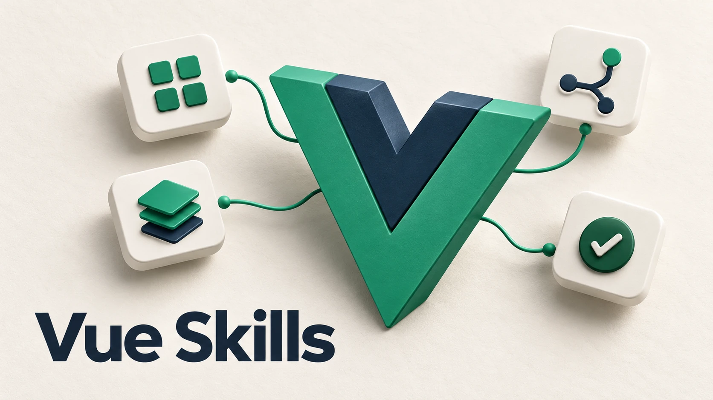

# Vue Skills

Develop Vue 3 applications with guidance for components, routing, state management, testing, and debugging.

## Overview

This community collection from vuejs-ai includes eight Skills covering Vue 3 with Composition API and TypeScript, Options API, Vue Router, Pinia, testing, JSX, debugging, and reusable composables. The upstream project is an early experiment; check its guidance against your project and installed versions.

## Scenarios

- Build Vue 3 components and reusable composables
- Configure navigation and Pinia stores
- Write component and end-to-end tests
- Diagnose runtime errors and hydration issues

## Usage

Install the collection and describe your Vue version, API style, and task. The author recommends starting prompts with `use vue skill`. Select the relevant Skill for implementation, testing, or debugging, and verify the result in your project.

## Skills

- [Vue development Skills](https://github.com/vuejs-ai/skills/tree/198f0cd8f7f9c0a3d9b566ccc16de6677519ee78/skills)

## Source

https://github.com/vuejs-ai/skills
