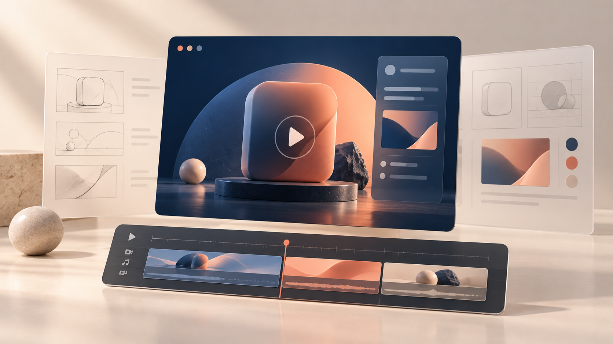

# 产品宣传视频

先明确需求，再制作画面，用 Skills 配合完成产品宣传视频。

## 合集介绍

按 302 AI 的公开案例整理需求梳理、视频制作与视觉设计能力。Skills 分别来自三个仓库；当前版本的配套安装清单由 Skills Hub 整理，不等于原文逐项推荐。这里只收录 Skills，不包含录屏、音乐与后期工具，也不包含示例项目或成片。

## 适用场景

- 产品演示
- 功能介绍
- 发布宣传片

## 使用建议

先讨论卖点、观众与视频目标，再让 Agent 制作画面，结合设计指导与预览调整视觉。按项目需要自行准备素材和其他工具。

## 技能

- [Brainstorming](https://github.com/obra/superpowers/blob/8ca22dba9a94f28898bbce59f2537ff4d87c747d/skills/brainstorming/SKILL.md)
- [Remotion Skills](https://github.com/remotion-dev/skills/tree/a1b09e904a995f8bbf6d3b865fc612eedf7a4c43/skills)
- [UI UX Pro Max](https://github.com/nextlevelbuilder/ui-ux-pro-max-skill/blob/09170eec67eefd46a7ae85de61b40c194020f997/.claude/skills/ui-ux-pro-max/SKILL.md)

## 来源

https://302.ai/blog/302-ai-best-practice-how-to-use-remotion-skill-to-make-video/
