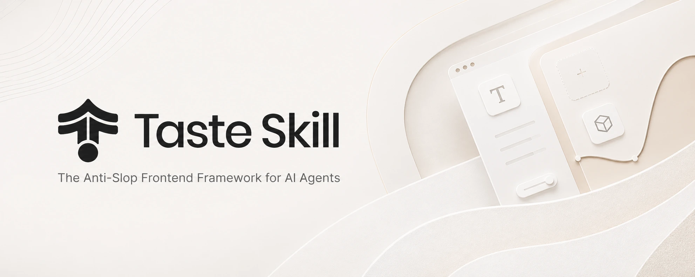

# Taste Skill · 前端设计



从排版、风格到动效，让 AI 生成的界面更有设计感。

## 概览

收录网页设计、已有项目改版与视觉风格指导，也包含网页、移动界面和品牌视觉的图片生成能力。可以探索设计方向，也可以直接构建或改进页面。

## 适用场景

- 官网与作品集
- 已有界面改版
- 设计与品牌提案

## 使用建议

按任务选择：新页面用前端设计，已有界面用改版指导；需要视觉探索时，先生成参考图，再交给编码 Agent 实现。

## Skills

### design-taste-frontend

根据需求选择设计方向，为落地页、作品集与改版构建界面。

```yaml
id: design-taste-frontend
entry:
  repo: Leonxlnx/taste-skill
  commit: ce26fc25c0e5e8cab638f883de62d9a86ee5e45b
  entryPoint: skills/taste-skill/SKILL.md
installationMode: skill
installationItems:
  - name: design-taste-frontend
    repo: Leonxlnx/taste-skill
    commit: ce26fc25c0e5e8cab638f883de62d9a86ee5e45b
    directory: skills/taste-skill
    entryPoint: SKILL.md
    license:
      identifier: MIT
      evidenceUrl: https://github.com/Leonxlnx/taste-skill/blob/ce26fc25c0e5e8cab638f883de62d9a86ee5e45b/LICENSE
resourceCheck: needs-review
resourceNotes: 入口路径已按固定提交的目录树核对；完整目录资源引用、目录外依赖和安装环境仍需逐项复核。
originalDescription: Anti-slop frontend skill for landing pages, portfolios, and redesigns. The agent reads the brief, infers the right design direction, and ships interfaces that do not look templated. Real design systems when applicable, audit-first on redesigns, strict pre-flight check.
```

### redesign-existing-projects

审查现有网站与应用设计，在保留功能的同时改善视觉质量。

```yaml
id: redesign-existing-projects
entry:
  repo: Leonxlnx/taste-skill
  commit: ce26fc25c0e5e8cab638f883de62d9a86ee5e45b
  entryPoint: skills/redesign-skill/SKILL.md
installationMode: skill
installationItems:
  - name: redesign-existing-projects
    repo: Leonxlnx/taste-skill
    commit: ce26fc25c0e5e8cab638f883de62d9a86ee5e45b
    directory: skills/redesign-skill
    entryPoint: SKILL.md
    license:
      identifier: MIT
      evidenceUrl: https://github.com/Leonxlnx/taste-skill/blob/ce26fc25c0e5e8cab638f883de62d9a86ee5e45b/LICENSE
resourceCheck: needs-review
resourceNotes: 入口路径已按固定提交的目录树核对；完整目录资源引用、目录外依赖和安装环境仍需逐项复核。
originalDescription: Upgrades existing websites and apps to premium quality. Audits current design, identifies generic AI patterns, and applies high-end design standards without breaking functionality. Works with any CSS framework or vanilla CSS.
```

### high-end-visual-design

细化字体、留白、阴影与动效，建立精致的网站视觉规范。

```yaml
id: high-end-visual-design
entry:
  repo: Leonxlnx/taste-skill
  commit: ce26fc25c0e5e8cab638f883de62d9a86ee5e45b
  entryPoint: skills/soft-skill/SKILL.md
installationMode: skill
installationItems:
  - name: high-end-visual-design
    repo: Leonxlnx/taste-skill
    commit: ce26fc25c0e5e8cab638f883de62d9a86ee5e45b
    directory: skills/soft-skill
    entryPoint: SKILL.md
    license:
      identifier: MIT
      evidenceUrl: https://github.com/Leonxlnx/taste-skill/blob/ce26fc25c0e5e8cab638f883de62d9a86ee5e45b/LICENSE
resourceCheck: needs-review
resourceNotes: 入口路径已按固定提交的目录树核对；完整目录资源引用、目录外依赖和安装环境仍需逐项复核。
originalDescription: Teaches the AI to design like a high-end agency. Defines the exact fonts, spacing, shadows, card structures, and animations that make a website feel expensive. Blocks all the common defaults that make AI designs look cheap or generic.
```

### image-to-code

先生成并分析设计图，再按图实现各个网站页面区域。

```yaml
id: image-to-code
entry:
  repo: Leonxlnx/taste-skill
  commit: ce26fc25c0e5e8cab638f883de62d9a86ee5e45b
  entryPoint: skills/image-to-code-skill/SKILL.md
installationMode: skill
installationItems:
  - name: image-to-code
    repo: Leonxlnx/taste-skill
    commit: ce26fc25c0e5e8cab638f883de62d9a86ee5e45b
    directory: skills/image-to-code-skill
    entryPoint: SKILL.md
    license:
      identifier: MIT
      evidenceUrl: https://github.com/Leonxlnx/taste-skill/blob/ce26fc25c0e5e8cab638f883de62d9a86ee5e45b/LICENSE
resourceCheck: needs-review
resourceNotes: 入口路径已按固定提交的目录树核对；完整目录资源引用、目录外依赖和安装环境仍需逐项复核。
originalDescription: Elite website image-to-code skill for Codex. For visually important web tasks, it must first generate the design image(s) itself, deeply analyze them, then implement the website to match them as closely as possible. In Codex, it must prefer large, readable, section-specific images instead of tiny compressed boards, generate fresh standalone images for sections or detail views instead of cropping old ones, avoid lazy under-generation, avoid cards-inside-cards-inside-cards UI, and keep the hero clean, spacious, readable, and visible on a small laptop.
```

### imagegen-frontend-web

为网站各个区块单独生成设计参考图，保持统一视觉风格。

```yaml
id: imagegen-frontend-web
entry:
  repo: Leonxlnx/taste-skill
  commit: ce26fc25c0e5e8cab638f883de62d9a86ee5e45b
  entryPoint: skills/imagegen-frontend-web/SKILL.md
installationMode: skill
installationItems:
  - name: imagegen-frontend-web
    repo: Leonxlnx/taste-skill
    commit: ce26fc25c0e5e8cab638f883de62d9a86ee5e45b
    directory: skills/imagegen-frontend-web
    entryPoint: SKILL.md
    license:
      identifier: MIT
      evidenceUrl: https://github.com/Leonxlnx/taste-skill/blob/ce26fc25c0e5e8cab638f883de62d9a86ee5e45b/LICENSE
resourceCheck: needs-review
resourceNotes: 入口路径已按固定提交的目录树核对；完整目录资源引用、目录外依赖和安装环境仍需逐项复核。
originalDescription: Elite frontend image-direction skill for generating premium, conversion-aware website design references. CRITICAL OUTPUT RULE — generate ONE separate horizontal image FOR EVERY section. A landing page with 8 sections produces 8 images. Never compress multiple sections into one image. Enforces composition variety (not always left-text / right-image), background-image freedom, varied CTAs, varied hero scales (giant / mid / mini minimalist), narrative concept spine, second-read moments, and a single consistent palette across all images. Optimized for landing pages, marketing sites, and product comps that developers or coding models can accurately recreate.
```

### minimalist-ui

用暖色单色系、清晰排版与扁平网格，构建极简编辑式界面。

```yaml
id: minimalist-ui
entry:
  repo: Leonxlnx/taste-skill
  commit: ce26fc25c0e5e8cab638f883de62d9a86ee5e45b
  entryPoint: skills/minimalist-skill/SKILL.md
installationMode: skill
installationItems:
  - name: minimalist-ui
    repo: Leonxlnx/taste-skill
    commit: ce26fc25c0e5e8cab638f883de62d9a86ee5e45b
    directory: skills/minimalist-skill
    entryPoint: SKILL.md
    license:
      identifier: MIT
      evidenceUrl: https://github.com/Leonxlnx/taste-skill/blob/ce26fc25c0e5e8cab638f883de62d9a86ee5e45b/LICENSE
resourceCheck: needs-review
resourceNotes: 入口路径已按固定提交的目录树核对；完整目录资源引用、目录外依赖和安装环境仍需逐项复核。
originalDescription: Clean editorial-style interfaces. Warm monochrome palette, typographic contrast, flat bento grids, muted pastels. No gradients, no heavy shadows.
```

### brandkit

生成品牌规范、标志系统与视觉提案，统一整体品牌风格。

```yaml
id: brandkit
entry:
  repo: Leonxlnx/taste-skill
  commit: ce26fc25c0e5e8cab638f883de62d9a86ee5e45b
  entryPoint: skills/brandkit/SKILL.md
installationMode: skill
installationItems:
  - name: brandkit
    repo: Leonxlnx/taste-skill
    commit: ce26fc25c0e5e8cab638f883de62d9a86ee5e45b
    directory: skills/brandkit
    entryPoint: SKILL.md
    license:
      identifier: MIT
      evidenceUrl: https://github.com/Leonxlnx/taste-skill/blob/ce26fc25c0e5e8cab638f883de62d9a86ee5e45b/LICENSE
resourceCheck: needs-review
resourceNotes: 入口路径已按固定提交的目录树核对；完整目录资源引用、目录外依赖和安装环境仍需逐项复核。
originalDescription: Premium brand-kit image generation skill for creating high-end brand-guidelines boards, logo systems, identity decks, and visual-world presentations. Trained for minimalist, cinematic, editorial, dark-tech, luxury, cultural, security, gaming, developer-tool, and consumer-app brand systems. Optimized for intentional logo concepting, refined composition, sparse typography, strong symbolic meaning, premium mockups, art-directed imagery, and flexible grid layouts.
```

### industrial-brutalist-ui

以瑞士排版与军事终端风格，设计机械感数据界面。

```yaml
id: industrial-brutalist-ui
entry:
  repo: Leonxlnx/taste-skill
  commit: ce26fc25c0e5e8cab638f883de62d9a86ee5e45b
  entryPoint: skills/brutalist-skill/SKILL.md
installationMode: skill
installationItems:
  - name: industrial-brutalist-ui
    repo: Leonxlnx/taste-skill
    commit: ce26fc25c0e5e8cab638f883de62d9a86ee5e45b
    directory: skills/brutalist-skill
    entryPoint: SKILL.md
    license:
      identifier: MIT
      evidenceUrl: https://github.com/Leonxlnx/taste-skill/blob/ce26fc25c0e5e8cab638f883de62d9a86ee5e45b/LICENSE
resourceCheck: needs-review
resourceNotes: 入口路径已按固定提交的目录树核对；完整目录资源引用、目录外依赖和安装环境仍需逐项复核。
originalDescription: Raw mechanical interfaces fusing Swiss typographic print with military terminal aesthetics. Rigid grids, extreme type scale contrast, utilitarian color, analog degradation effects. For data-heavy dashboards, portfolios, or editorial sites that need to feel like declassified blueprints.
```

### gpt-taste

编排编辑式页面布局，并用 GSAP 实现滚动与微动效。

```yaml
id: gpt-taste
entry:
  repo: Leonxlnx/taste-skill
  commit: ce26fc25c0e5e8cab638f883de62d9a86ee5e45b
  entryPoint: skills/gpt-tasteskill/SKILL.md
installationMode: skill
installationItems:
  - name: gpt-taste
    repo: Leonxlnx/taste-skill
    commit: ce26fc25c0e5e8cab638f883de62d9a86ee5e45b
    directory: skills/gpt-tasteskill
    entryPoint: SKILL.md
    license:
      identifier: MIT
      evidenceUrl: https://github.com/Leonxlnx/taste-skill/blob/ce26fc25c0e5e8cab638f883de62d9a86ee5e45b/LICENSE
resourceCheck: needs-review
resourceNotes: 入口路径已按固定提交的目录树核对；完整目录资源引用、目录外依赖和安装环境仍需逐项复核。
originalDescription: Elite UX/UI & Advanced GSAP Motion Engineer. Enforces Python-driven true randomization for layout variance, strict AIDA page structure, wide editorial typography (bans 6-line wraps), gapless bento grids, strict GSAP ScrollTriggers (pinning, stacking, scrubbing), inline micro-images, and massive section spacing.
```

### imagegen-frontend-mobile

生成风格一致的移动应用界面概念图与流程，仅输出图片。

```yaml
id: imagegen-frontend-mobile
entry:
  repo: Leonxlnx/taste-skill
  commit: ce26fc25c0e5e8cab638f883de62d9a86ee5e45b
  entryPoint: skills/imagegen-frontend-mobile/SKILL.md
installationMode: skill
installationItems:
  - name: imagegen-frontend-mobile
    repo: Leonxlnx/taste-skill
    commit: ce26fc25c0e5e8cab638f883de62d9a86ee5e45b
    directory: skills/imagegen-frontend-mobile
    entryPoint: SKILL.md
    license:
      identifier: MIT
      evidenceUrl: https://github.com/Leonxlnx/taste-skill/blob/ce26fc25c0e5e8cab638f883de62d9a86ee5e45b/LICENSE
resourceCheck: needs-review
resourceNotes: 入口路径已按固定提交的目录树核对；完整目录资源引用、目录外依赖和安装环境仍需逐项复核。
originalDescription: Elite mobile app image-generation skill for creating premium, app-native screen concepts and flows. Designed for iOS, Android, and cross-platform mobile products. Prioritizes clean hierarchy, comfortably readable text, strong multi-screen consistency, controlled color palettes, non-generic creative direction, textured surfaces, image-led composition, tasteful custom iconography, and clean phone mockup framing. By default, screens should be shown inside a subtle premium iPhone or similar phone mockup with a visible frame, while the main focus stays on the app content itself. This skill generates images only. It does not write code.
```

### full-output-enforcement

强制完整输出代码，避免占位内容并处理超长输出分段。

```yaml
id: full-output-enforcement
entry:
  repo: Leonxlnx/taste-skill
  commit: ce26fc25c0e5e8cab638f883de62d9a86ee5e45b
  entryPoint: skills/output-skill/SKILL.md
installationMode: skill
installationItems:
  - name: full-output-enforcement
    repo: Leonxlnx/taste-skill
    commit: ce26fc25c0e5e8cab638f883de62d9a86ee5e45b
    directory: skills/output-skill
    entryPoint: SKILL.md
    license:
      identifier: MIT
      evidenceUrl: https://github.com/Leonxlnx/taste-skill/blob/ce26fc25c0e5e8cab638f883de62d9a86ee5e45b/LICENSE
resourceCheck: needs-review
resourceNotes: 入口路径已按固定提交的目录树核对；完整目录资源引用、目录外依赖和安装环境仍需逐项复核。
originalDescription: Overrides default LLM truncation behavior. Enforces complete code generation, bans placeholder patterns, and handles token-limit splits cleanly. Apply to any task requiring exhaustive, unabridged output.
```

### stitch-design-taste

为 Google Stitch 生成设计规范文档，约束排版、配色与动效。

```yaml
id: stitch-design-taste
entry:
  repo: Leonxlnx/taste-skill
  commit: ce26fc25c0e5e8cab638f883de62d9a86ee5e45b
  entryPoint: skills/stitch-skill/SKILL.md
installationMode: skill
installationItems:
  - name: stitch-design-taste
    repo: Leonxlnx/taste-skill
    commit: ce26fc25c0e5e8cab638f883de62d9a86ee5e45b
    directory: skills/stitch-skill
    entryPoint: SKILL.md
    license:
      identifier: MIT
      evidenceUrl: https://github.com/Leonxlnx/taste-skill/blob/ce26fc25c0e5e8cab638f883de62d9a86ee5e45b/LICENSE
resourceCheck: needs-review
resourceNotes: 入口路径已按固定提交的目录树核对；完整目录资源引用、目录外依赖和安装环境仍需逐项复核。
originalDescription: Semantic Design System Skill for Google Stitch. Generates agent-friendly DESIGN.md files that enforce premium, anti-generic UI standards — strict typography, calibrated color, asymmetric layouts, perpetual micro-motion, and hardware-accelerated performance.
```

### design-taste-frontend-v1

保留第一版前端设计行为，供需要兼容旧项目的场景使用。

```yaml
id: design-taste-frontend-v1
entry:
  repo: Leonxlnx/taste-skill
  commit: ce26fc25c0e5e8cab638f883de62d9a86ee5e45b
  entryPoint: skills/taste-skill-v1/SKILL.md
installationMode: skill
installationItems:
  - name: design-taste-frontend-v1
    repo: Leonxlnx/taste-skill
    commit: ce26fc25c0e5e8cab638f883de62d9a86ee5e45b
    directory: skills/taste-skill-v1
    entryPoint: SKILL.md
    license:
      identifier: MIT
      evidenceUrl: https://github.com/Leonxlnx/taste-skill/blob/ce26fc25c0e5e8cab638f883de62d9a86ee5e45b/LICENSE
resourceCheck: needs-review
resourceNotes: 入口路径已按固定提交的目录树核对；完整目录资源引用、目录外依赖和安装环境仍需逐项复核。
originalDescription: The original v1 taste-skill, preserved for projects depending on its exact behavior. The current default is `design-taste-frontend` (v2 experimental), which is a substantial rewrite. Use this v1 install name only if you need exact backward compatibility.
```
